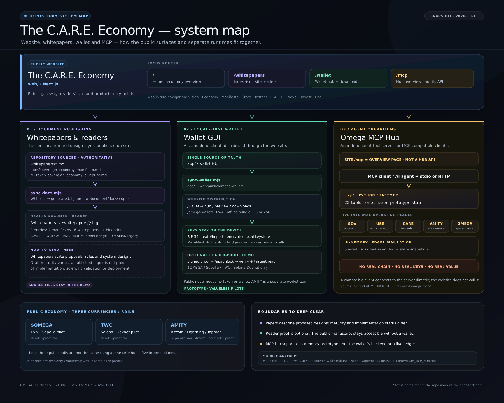

# Website, whitepapers, wallet and MCP — system map

**Repository snapshot:** 2026-10-11

This diagram is a repo-level map of how four related surfaces fit together. The website also presents it at the `/architecture` route when running. The map marks the important boundary: sharing a repository does **not** mean they are one live application or share one ledger.

## How to read it

- **Website (`web/`)** — Next.js public site. The map highlights `/whitepapers`, `/wallet`, and `/mcp`; the site also has other sections such as Vision, Economy, Manifesto, Store, Testnet, C.A.R.E., Novel, Invest, and Ops.
- **Whitepapers and documents** — Markdown sources in `whitepapers/`, the canonical manifesto in `docs/sovereign_economy_manifesto.md`, and the economy blueprint are copied by `web/scripts/sync-docs.mjs` into generated, ignored `web/content/docs/` files. The site renders the index at `/whitepapers` and individual entries at `/whitepapers/[slug]`. The current site registry has nine entries: two manifestos, six whitepapers, and one blueprint.
- **Wallet** — `app/` is the GUI source. `web/scripts/sync-wallet.mjs` publishes a generated copy at `web/public/omega-wallet/`; the website's `/wallet` page provides the hub, preview, install, and download paths. The wallet is local-first. Its optional reader-proof demo sends a signed statement for server verification and test-network checks; the public novel itself remains accessible without a token or wallet.
- **MCP Hub** — `mcp/` is a separate Python/FastMCP server used by a compatible MCP client over stdio or HTTP. Its five internal planes are SOV, USE, CARE, AMITY, and OMEGA. Its current state is an in-memory simulation with a shared versioned event log and snapshots; it does not connect to a live chain or hold real keys or value. The website's `/mcp` page is an overview, not the MCP server endpoint.

## Keep the two counts separate

The **three public economy currencies/rails** are `$OMEGA` (EVM; the current reader-proof pilot is on Sepolia), TWC (Solana; the current pilot is on Devnet), and AMITY (Bitcoin/Lightning/Taproot workstream). The MCP server's **five planes** are internal operating domains; they are not five public currencies. AMITY is not a reader-proof rail in the current website demo.

## Status boundary

The whitepapers are design/specification documents, with status varying by paper. The wallet's proof integrations are optional, test-only pilots. The MCP hub is a prototype simulation. None of those facts should be read as evidence of scientific validation, a live value-bearing economy, or a wallet-to-MCP integration. For scientific status and limitations, see the notices in [`README.md`](../README.md).

## Source anchors

- Website routes: [`web/src/app/page.tsx`](../web/src/app/page.tsx), [`web/src/app/whitepapers/page.tsx`](../web/src/app/whitepapers/page.tsx), [`web/src/app/wallet/page.tsx`](../web/src/app/wallet/page.tsx), [`web/src/app/mcp/page.tsx`](../web/src/app/mcp/page.tsx)
- Document registry and sync: [`web/src/lib/docs.ts`](../web/src/lib/docs.ts), [`web/scripts/sync-docs.mjs`](../web/scripts/sync-docs.mjs)
- Wallet distribution and proof API: [`app/README.md`](../app/README.md), [`web/src/components/WalletHub.tsx`](../web/src/components/WalletHub.tsx), [`web/src/app/api/unlock/route.ts`](../web/src/app/api/unlock/route.ts)
- MCP hub: [`mcp/README_MCP_HUB.md`](../mcp/README_MCP_HUB.md), [`mcp/omega_mcp/__init__.py`](../mcp/omega_mcp/__init__.py)
